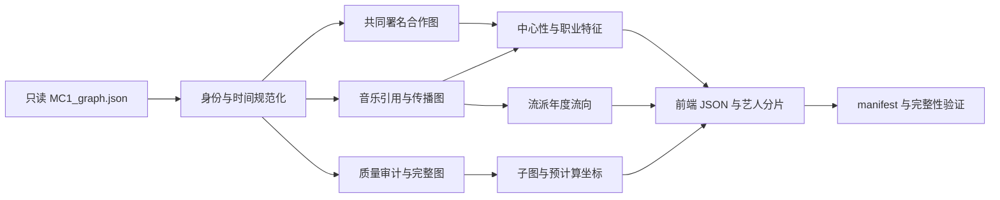

# 邬昊文 · 数据工程交接

更新日期：2026-11-04。对应 README 中“数据清洗、NetworkX 建图、图指标计算、导出前端数据”职责。开发分支：`feat/whw-data-pipeline`。

当前版本为 **v1.1.0**；在首轮工程交付上完善了影响证据、历年指标和规则敏感性，详见 [优化与稳健性说明](07-数据工程优化与稳健性.md)。原有文件和主要字段保留，新增三份分析产物。

## 交付范围

这条管线把官方音乐知识图谱转换为三个可视分析模块可直接使用的数据，并保留“结论 → 指标 → 作品/关系 ID → 原始记录”的核查路径。它不替代模块二、模块三的最终分析，也不自动提交答卷或发布网站。



从仓库根目录运行：

```powershell
python -m pip install -r pipeline/requirements.txt
python -m pipeline.run
python -m unittest discover -s pipeline/tests -v
node --test pipeline/tests/frontend.test.mjs
```

全量输出在 `data/processed/`，当前默认 84 份 JSON，约 72.5 MiB。生成物按仓库规则忽略；交接脚本、文档和测试即可。环境版本写入 manifest；固定随机种子 42，JSON 无生成时间等不可复现字段。

## 对赛题各问题的支持

| 官方问题 | 可交给分析者的数据 | 阅读时的限制 |
|---|---|---|
| 1.1 谁在不同时期影响 Sailor？ | `sailor_shift` 的作品、直接来源、上游路径、event_ids；事件的发行年份代理 | 艺人间直接关系无时间，不放入时间序列；来源次数不是影响强度真值 |
| 1.2 与谁合作、影响了谁？ | 48 位共同署名合作者；原始两跳结构图；独立的音乐影响路径 | 共同署名只说明参与同一作品，不说明亲密关系；结构路径不证明因果 |
| 1.3 对社区的作用？ | 合作者 work_ids、Oceanus Folk 作品数/角色/轨迹、明确的 MemberOf 记录 | 无成员加入/退出日期，不能推断在每首乐队作品上都有贡献 |
| 2.1 渐进或间歇？ | 年度外向事件量、5 年后向移动均值、跨流派事件占比、不同受影响作品覆盖率 | 发行量不等于影响力；数据采样不均，曲线形状不是显著性检验 |
| 2.2 影响哪些流派/艺人？ | 来源→受影响方向的流派流量、关系类型、事件 ID，表演者分摊的影响网络 | 同一作品可有不同关系类型，事件数与独立作品数分开提供 |
| 2.3 Oceanus Folk 从哪里吸收灵感？ | `genre_flows` 筛选 target=Oceanus Folk，按 source/type/year 聚合 | source/target 是影响传播方向，与原图引用方向相反 |
| 3.1 三艺人职业对比？ | 首次观察到的作品年、自然年/职业年轨迹、已知登榜时差、合作度、流派跨度 | 首次观察到的作品不是实际出道日期；缺失登榜日期不等于未登榜 |
| 3.2 未来五年三个预测？ | 截至 2040 的特征、2041–2045 预测期、探索候选与评分分项 | 未获得未来标签，不能声称模型准确率；最终预测和验证归模块三 |

## 三种图必须区分

1. **证据图**：17,412 节点 / 37,857 边的完整 `MultiDiGraph`。类型、方向、平行边 key、节点原属性保留。原图度数统计的是关系条数。
2. **合作图**：11,581 个具有直接作品署名的个人/组合，31,695 条无向边。同一作品的表演、作曲、作词、制作署名者两两相连，每个作品对一对艺人只增加 1。RecordLabel 不混入艺人中心性。
3. **影响图**：原始引用反转为来源→受影响者。艺人投影只把有日期的作品关系归到明确 PerformerOf 的表演者；每条关系的源/目标表演者笛卡尔积平分权重，自我影响扣除后不重新分配。得到 67,274 条有向艺人边。没有日期的 67 条直接艺人影响关系留在结构证据中。

合作 PageRank 使用共同作品数作为权重，阻尼 0.85。介数使用 `1/共同作品数` 作为距离，抽取 96 个源节点，明确标记为近似值。影响来源 PageRank 对影响图反向计算，使“被他人借鉴”能够贡献来源声望。各算法都不能单独充当人气、销量或因果影响的测量。

## 数据质量结论

- 官方说明写 18 个连通分量，本地按弱连通重算为 **16**；最大分量为 17,277 个节点。全量保留，不删除小分量。
- **84.90% 的 notable 作品缺失登榜年份**。只对 649 个有年份的作品计算登榜事件与发行→登榜时差，缺失保持 null。
- 84 条引用的发行时间顺序存疑、1 条自环从影响统计排除，原始记录不改。保留原图可让后续分析选择不同的处理口径。
- 550 条关系不完全符合官方文字端点模式：380 条乐队署名、103 条反向 RecordedBy、67 条艺人之间的音乐影响。前两类不能一概删除；合作投影允许乐队在作品上的有效署名，录制关系不参与合作度。
- 原图有重复姓名，也有三个重复署名关系。以 ID 保留实体，以“艺人 ID + 作品 ID + 角色集合”去重贡献。
- 官方叙事的乐队时间和本地译文存在出入，已经按官网更正；原图 `Ivy Echos` 的拼写保留。

## 候选榜为什么只是基线

默认候选条件为“有直接表演的 Oceanus Folk 作品，首次观察以来不超过 10 年”，得到 7 位个人/组合。默认不对近期没有发行记录者作不活跃判断；若加近三年发行条件，仅余 1 位。输出中提供 3 年/5 年窗口的候选数量对照。

打分为候选池内的并列中秩百分位加权：近五年作品数 20%、新合作者数 25%、近期被借鉴分摊量 25%、流派数 10%、近期作品占比 20%。**这些权重未经训练或验证**，只是让模块三有一个可复现的分析起点。输出会列出无区分力特征；例如全为零的影响量不能支持候选优劣判断。同分共享名次，ID 仅用于稳定显示顺序。

默认结果中“近期被借鉴分摊量”和“流派数”是常量特征；第三名存在五人并列。因此，直接截取列表前三行不能构成有依据的三人预测。模块三应回看无日期的直接影响证据、补充特征定义并做权重敏感性分析，而非把显示顺序当作胜负。

历史截面可用 `--cutoff 2035` 重算。未来发行作品、未来登榜年份、无日期影响关系不进入历史特征；2040 最终状态标签在更早截面不暴露为历史特征。原数据没有采集版本历史，成员关系没有日期，因此不能宣称这是完整的真实世界回测。数据工程部分没有捏造预测 Top3、p 值或准确率。

## 给组员的接入顺序

| 成员 | 先看什么 | 可以直接使用什么 |
|---|---|---|
| 付嘉一 | `docs/06-前端数据契约.md` 的 Vite 接入与方向约定 | 首屏概况、600 节点概览、269 节点 Sailor 布局、作品/合作者/路径 |
| 资丰瑞 | `genre_trends`、`genre_flows` 的字段和分母 | 26 个流派的年度曲线、五类影响的可筛选流向、逐条证据 |
| 周涛 | 历史截点规则、艺人分片、候选评分分项 | 三人轨迹对齐、缺失样本数、可重算特征及敏感性对照 |
| 隋咏轩 | 本文的数据质量与方法部分 | 可复核的技术说明、方法图及答辩素材；视觉结论仍以系统截图为准 |

可用于演示查询的真实 ID：Sailor Shift `17255`、Maya Jensen `17256`、Sophie Ramirez `17259`、Bea Azure `17349`、Kael Storm `17355`。这只是已验证的实体定位，不是预先指定的分析结论。

## 验证与可复现性

Python 测试覆盖 ID/多重边保留、错误输入拒绝、原始目录写保护、边方向、年份缺失、异常排除、合作去重、成员关系不外推、分摊权重、历史截面与未来证据不变性、流派分母、路径证据、布局确定性和真实数据回归。

前端测试覆盖分片查询、请求缓存与重试、版本混用拒绝、D3 数据副本隔离、稀疏轨迹补齐、Vite 开发路径及构建资产白名单。完整 `run.py` 还会验证每个产物的 SHA-256、来源一致性、图引用、流量守恒、职业累计量和布局端点。

### v1.0 首轮验证记录（2026-11-04；保留历史，当前结果见下节）

| 验证 | 结果 |
|---|---|
| `python -m pipeline.run` | 完整真实数据通过，81 个 JSON；最终一次默认运行约 6.8 秒 |
| `python -m unittest discover -s pipeline/tests -v` | 23 项全部通过 |
| `node --test pipeline/tests/frontend.test.mjs` | 6 项全部通过；覆盖适配器 hook 和真实分片，未声称完成前端页面验收 |
| 独立进程重建，设置 `PYTHONHASHSEED=73` | 全部 81 个文件（含 manifest）逐字节一致 |
| `python -m pipeline.run --cutoff 2035 --out data/processed/snapshots/2035` | 历史截面完整生成并通过校验，单独保留在对应目录 |
| 原始文件核对 | 三份原始文件的 SHA-256 与开始时一致；Git 中 raw 无差异 |
| 协作范围核对 | `web/` 无改动；processed 根目录、艺人分片和历史截面均被 gitignore 覆盖 |

测试通过只保证上述工程性质，不表示分析假设和预测效果已被验证。首轮验证时，代码及文档保留在本地分支；交付时按组内分支与 PR 流程提交。

### v1.1 优化验证记录（2026-11-04）

| 验证 | 结果 |
|---|---|
| 完整真实数据运行 | 84 份 JSON，全部交叉核验通过，本次默认约 14.2 秒 |
| Python 语义和真实数据回归测试 | 45 项全部通过 |
| 前端适配器测试 | 8 项全部通过，含新产物按需加载与小版本混用拒绝 |
| 独立进程、不同 `PYTHONHASHSEED` 重建 | 全部 84 个文件（含 manifest）逐字节一致 |
| 2035 历史截面 | 新旧产物一并生成，84 个文件完整通过验证 |
| 作用范围 | 数据源仍为同一原始图；原有前端页面、组件和最终分析分工保持原状 |

新版 `influence_evidence.json` 中 58 个来源关联艺人与旧版 30 个来源实体**不是同一统计对象**：前者沿明确的作品表演署名归属到艺人，后者包含作品和艺人等原始实体。推导都附有原始边路径，不能将数量差解释成“真实影响变大”。

## 参考依据

- [官方赛题：背景与任务](https://vast-challenge.github.io/2025/MC1.html)，核对时间 2026-11-04。
- `data/raw/MC1-数据说明-官方.docx`：节点/边语义、合成数据与单赛题数据边界；仅用于阅读，未修改。
- [项目 GitHub README](https://github.com/LJL-11/vast2025-mc1-oceanuspulse)：分工、目录、分支与原始数据规则。
- [NetworkX PageRank](https://networkx.org/documentation/stable/reference/algorithms/generated/networkx.algorithms.link_analysis.pagerank_alg.pagerank.html)、[介数中心性](https://networkx.org/documentation/stable/reference/algorithms/generated/networkx.algorithms.centrality.betweenness_centrality.html)：算法定义；本管线锁定 NetworkX 3.5。

所有音乐行业分析数据均来自本赛题原始图；没有引入真实艺人、外部音乐数据或其他 Mini-Challenge 的数据。
