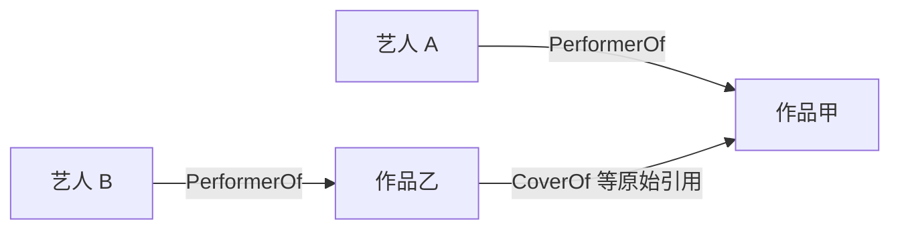

# 数据工程 v1.1：影响证据、历年指标与规则稳健性

负责人：邬昊文。日期：2026-11-04。分支：`feat/whw-data-pipeline`。

## 本次优化属于什么工作

范围仍是 README 中的数据工程职责：读取官方图、建立有含义的图投影、计算指标、导出前端数据并验证其依据。现有页面开发、模块二的传播结论、模块三的最终预测与检验仍由原负责人完成。

原始数据保持 17,412 个节点、37,857 条边，三份原始文件 SHA-256 不变。在原有产物上新增三份 JSON，默认由 81 份变为 **84 份**；此前的主要字段保留，契约升至 1.1.0。

| 优化方向 | 新代码 | 新产物 | 实际用途 |
|---|---|---|---|
| 有证据的影响计算 | `pipeline/influence.py` | `influence_evidence.json` | 分清明确的艺人引用与通过作品署名推导的联系，点回原始关系 |
| 历年与滚动变化 | `pipeline/temporal.py` | `network_dynamics.json` | 比较“截至当年累计”和“近五年活跃”，并按当年网络重算指标 |
| 规则敏感性 | `pipeline/robustness.py`、`rankings.py` | `robustness_report.json` | 比较规则变化带来的排名变化，保留并列及无信息状态 |

这些是对同一数据的加工与核验，不会把推导联系写回 raw 或当作新增的原始事实。

## 一、每条影响能解释到什么程度

### 明确关系与作品归属分开

原图五类音乐引用共有 7,407 条，其中：

- 67 条是艺人/组合之间的明确引用关系，均没有发生年份；保留为原始结构证据。
- 7,340 条是作品之间的关系；其中 84 条存在发行时间顺序疑点、1 条自环，默认有日期分析仍使用 7,255 条。

作品之间的引用可以沿明确的 `PerformerOf` 署名归属到艺人。例如，作品乙引用作品甲，艺人 A 表演甲、艺人 B 表演乙，则导出 A 与 B 的**作品归属联系**，并提供三个原始边 ID：



沿推导方向 A→甲→乙→B 阅读时，第二、三步逆着原始边行走，所以路径明确记录 forward/reverse。推导联系不证明 A 与 B 私下合作、个人交往或因果影响。

一条关系有 m 位来源表演者、n 位受影响表演者时，每个不同艺人对分到 `1/(m*n)`；自我归属剔除后不重新分配。不同署名角色、重复署名边不会让同一艺人重复分得权重。原始引用、角色、署名边和抽样展示路径都保留，可以核查到底。

### 2040 默认结果

Sailor 的新证据文件给出 58 个来源关联艺人、7 个下游关联艺人。旧文件中的 30 个来源是原始作品/艺人实体，新文件沿署名归属到艺人，统计对象不同，不能据数字差宣称影响扩大。

尤其需要保留的事实是：**Sailor 当前七个下游关联的引用全部没有日期**。优化没有把这些关系补成某年，也没有据此生成虚假的年度影响增长。日期不足本身是需要交代的数据限制。

## 二、历年变化真正重新计算

默认对比对象为 Sailor、原乐队成员及至多十位当前候选，本次共 12 个。艺人年度序列覆盖 2024–2040；每年的图都包含完整的当年可见署名网络，计算完再抽取对比对象。不是只在这 12 人的子图上计算中心性。

每年只使用当年及以前发行的作品与已知发生的登榜记录；无日期艺人引用不进入年度影响。提供三组指标：

- **累计**：作品数、共同署名合作者数、合作 PageRank 和并列百分位、已知登榜数、有日期影响分摊量、跨流派连接情况。
- **滚动窗口**：默认近五年作品、活跃合作者、新合作者、有日期影响分摊量。
- **年度新增**：新作品、新合作者、新增影响量与合作度同比；首次观察年同比为 null。

PageRank 的原始分数会受网络规模影响，故同时提供当年网络内的百分位。百分位是相对位置，不是成名概率；无有日期影响证据者不获得影响来源百分位。

窗口内的新作品引用早期老作品时，老作品仍作为来源保留。近期活跃合作者包含旧伙伴，新合作者则要求首次共同署名发生在窗口内，两者不能混用。

### 可核查的时间对比示例

下表是四类直接创作署名合并去重后的作品和合作记录，不等于实际出道时间、独立歌曲销量或私人合作关系。

| 年份 | Sailor 累计作品实体 | 累计共同署名合作者 | 近五年活跃合作者 |
|---|---:|---:|---:|
| 2024 | 1 | 8 | 8 |
| 2028 | 8 | 10 | 10 |
| 2035 | 28 | 41 | 26 |
| 2040 | 38 | 48 | 16 |

例如，2040 的“累计 48 个合作者”和“近五年活跃 16 个合作者”回答不同问题，不能从累计度数直接推断近期合作仍在同速增长。

流派滚动统计覆盖 1975–2040，包含跨流派引用量、占比、独立受影响作品数、外部目标流派数和前后两个非重叠窗口的差值。数据跨度不足两整窗时差值为 null，避免将观察期之前的空白当作真实零值。变化幅度仍需分析者结合证据判断，不能自动解释为因果或显著爆发。

## 三、改变规则后，结果是否仍一致

预先定义七套规则，默认均不把无日期艺人关系纳入年度分析；“纳入时间疑点”也只允许截点前可见的作品。

| 场景 | 有日期引用条数 | 改变的计算定义 |
|---|---:|---|
| 基准 | 7,255 | 五类引用、排除时间疑点、归属明确表演者 |
| 纳入时间疑点 | 7,339 | 加回 84 条时间存疑关系；仍剔除自环与重复语义关系 |
| 只看风格借鉴 | 2,236 | 只保留 InStyleOf |
| 录音/作品复用 | 3,559 | CoverOf、DirectlySamples、InterpolatesFrom |
| 不含歌词引用 | 5,795 | 去掉 LyricalReferenceTo |
| 各关系类型等总量 | 7,255 | 五类各占相同总权重；总权重与基准相同 |
| 四类创作署名归属 | 7,255 | 表演/作曲/作词/制作的明确艺人署名；同一艺人不因多角色重复计算 |

艺人比较指标是“作为引用来源的分摊量”，流派比较指标是“向其他流派传播的加权事件量”。对照的是计算定义的敏感性，**不是检验谁真实更红，也不是挑出一套最有利的模型**。

使用支持并列的 Spearman 排名相关系数和 Top-k 集合重合度。影响比较只看至少在一个场景有正分的对象，避免大量共同为零的艺人制造虚假的稳定。常量或样本不足时相关系数为 null；两个空 Top 集合的重合度也为 null。未输出 p 值、预测准确率或置信概率。

### 本次默认数据上的描述性结果

| 与基准相比 | 艺人排名 Spearman | 流派前五集合重合度 |
|---|---:|---:|
| 纳入时间疑点 | 0.9903 | 1.0000 |
| 只看风格借鉴 | 0.5942 | 1.0000 |
| 录音/作品复用 | 0.7282 | 0.6667 |
| 四类创作署名归属 | 0.6246 | 1.0000 |

在本次定义下，艺人排序对“纳入哪类音乐关系、归属哪些贡献者”更敏感，单独加回时间存疑关系的变化较小。不同场景表达不同问题，相关系数低不自动说明某个算法错误。录音复用场景的流派前五中 Psychedelic Rock 进入、Southern Gothic Rock 离开；其余场景的相同前五集合也不保证内部名次相同。

### 候选榜没有被强行凑成三人

固定原有候选集合，测试原始权重、剔除常量后归一化、五项等权、侧重产出、侧重网络五套权重。原始打分有 **35% 权重落在常量特征上**，这部分不会提供区分信息。

本次五套权重的排名相关系数均为 1，但第三名仍有五人并列。按 Top3 边界保留所有并列者，集合就有七人，`unique_top_k_set=false`。这揭示当前特征不足以唯一选三人的限制，而不是验证了某三人的预测。

移除常量并重新归一化能让评分解释更清楚，本身不会创造新的信息或打破真实并列。后续模块三应结合明确的无日期结构证据、职业对比和特征定义继续判断；本轮优化没有代替其最终预测工作。

## 运行、接入与验证

```powershell
# 完整生成与验收
python -m pipeline.run
python -m pipeline.validate

# 指定额外对比对象；单独输出，不覆盖默认交付
python -m pipeline.run --compare-ids 17349 17355 --out data/processed/comparison

# 更早观察截点；并不是拿未来关系重画一张过去的图
python -m pipeline.run --cutoff 2035 --out data/processed/snapshots/2035
```

浏览器数据服务新增 `influenceEvidence()`、`networkDynamics()`、`robustness()`，均按需加载；原有方法保持。新产物约 6.6 MiB、714 KiB、56 KiB，不在首屏一次性请求。具体字段、滚动窗口和版本规则见 [前端数据契约](06-前端数据契约.md)。

| 验证项目 | 本次结果 |
|---|---|
| 完整真实数据 | 84 份 JSON，通过原始属性、哈希、图引用和新旧指标交叉核验；默认一次约 14.2 秒 |
| Python 测试 | 45 项全部通过，含小图手算、路径方向、多角色去重、自我归属、未来信息不变性、老作品跨窗口保留、并列与常量情形 |
| 前端适配器测试 | 8 项全部通过，含 1.1 契约、新产物按需加载和混合版本拒绝 |
| 独立进程复现 | 改变 `PYTHONHASHSEED`，84 个文件（含 manifest）逐字节一致 |
| 2035 截面 | 84 个文件完整生成并通过校验 |

代码通过 `feat/whw-data-pipeline` 分支提交 PR，由组长审核合并。原始文件、其他成员前端代码和生成物不入库的约定保持。

提交前已同步主分支的模块三成果：保留其 `pipeline/features.py`，数据工程通用特征使用 `pipeline/artist_features.py`，两者的输出文件互不覆盖。保留模块三依赖和原有运行说明；Vite 适配器对模块三既有静态资源路径直接放行，交由原有静态服务处理。

## 方法依据

- [官方任务](https://vast-challenge.github.io/2025/MC1.html)：影响来源、传播随时间变化、职业比较等问题。
- 原始 `MC1-数据说明-官方.docx` 与 `MC1_graph.json`：引用方向、作品角色、日期及缺失情况；没有补充外部音乐数据。
- [NetworkX 3.5 PageRank](https://networkx.org/documentation/networkx-3.5/reference/algorithms/generated/networkx.algorithms.link_analysis.pagerank_alg.pagerank.html)：在指定有向网络上按结构计算相对分数。
- [SciPy 1.15.2 spearmanr](https://docs.scipy.org/doc/scipy-1.15.2/reference/generated/scipy.stats.spearmanr.html)：本轮只使用相关系数，常量情形明确保持不可计算。
